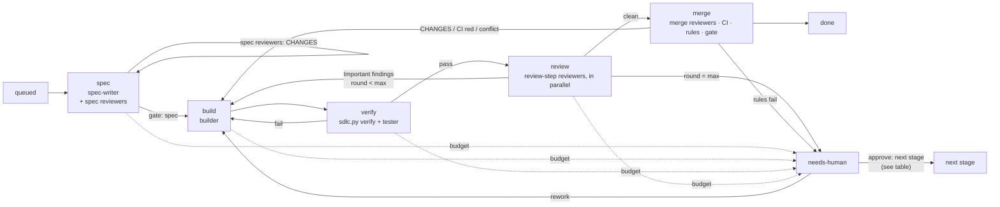

# Claude Code SDLC Plugin

Build a Claude Code **plugin** named `sdlc` that takes a feature from idea to merged code: **spec → build → verify → review → merge**. Along the way it enforces token budgets, records what happened, and ends each job with a retro so the next run does better. Extensions add a settings UI, team boards, and release with monitoring and rollback.

**Principles**

- **Small.** Part 1 (Core) is a complete system. Part 2 (Extensions) plugs into defined extension points: adapters, reviewer steps, gates, commands and dashboard tabs.
- **Artifacts, not conversation.** Agents get context from job files, never from the conversation, and each agent writes only its own files.
- **Self-contained jobs.** Everything about a job lives in its own folder, `.sdlc/job-<n>/`. Deleting the folder removes the job cleanly and breaks nothing else (§4).
- **Built-ins first.** Use Claude Code's own features instead of rebuilding them, in particular `/code-review` with `REVIEW.md` and `/security-review` (§10).
- **The repo decides.** `SDLC.md` holds every repo-specific choice: extra reviewers and when to run them, integrations, rules and learnings. **The only integration the plugin ships is GitHub, through `gh`.** It also works with nothing but local files and git. The repo connects Jira, GitLab or anything else through `SDLC.md` (§6).
- **Scripts first.** Anything that doesn't need judgment is done by `sdlc.py` or a repo command, at no token cost. The split is in §4.

---

# Part 1: Core

## 1. Layout

**Plugin repo (this repo)**

```text
.claude-plugin/plugin.json    # name "sdlc", version
skills/<command>/SKILL.md     # one per command, invoked as /sdlc:<command>
agents/                       # spec-writer, builder, tester, reviewer (generic, runs repo instructions)
hooks/hooks.json              # 4 hooks (§8)
scripts/
  sdlc.py                     # the one CLI: config, board, verify, review, learn, adapter, hook, serve (+ check in E3)
                              # includes the built-in adapters: files board, local git host, github (via gh)
reference/
  pipeline.md                 # the short `sdlc.py next` loop the skills follow
  formats.md                  # artifact formats (§4)
  adapters.md                 # the adapter contract (§6), used by init to help write the repo's adapters
  (no pipeline logic here: it lives in sdlc.py, so skills stay small)
templates/
  SDLC.md  REVIEW.md  sdlc.schema.json
  dashboard.html              # served straight from the plugin, never copied
evals/
```

**Target repo (where the plugin is used)**, shown with its parent folder, because worktrees live next to the repo, not inside it:

```text
~/dev/
├── shop/                         # the repo
│   ├── SDLC.md                   # committed: settings, reviewers, adapters, pipeline rules, Answers, Learnings
│   ├── REVIEW.md                 # committed: Claude Code review rules, used by the built-in code review
│   ├── review-*.md               # committed, optional: instructions for repo-defined reviewers (§5)
│   ├── .claude/principles/*.md   # committed: how the repo does things (architecture, design system ...), listed in global.principle.list (§2)
│   ├── tools/sdlc/*              # committed, optional: the repo's command adapters (§6), any path
│   └── .sdlc/                    # gitignored; /sdlc:init adds it to .gitignore
│       ├── backlog.md            # items not started yet; an item leaves the backlog when its job starts
│       ├── counter               # last job number used (files board only), so numbers are never reused
│       ├── config-events.jsonl   # settings changes made in the Settings UI (E1)
│       ├── usage/
│       │   └── 2026-11.jsonl     # token ledger, one file per budget month
│       └── job-123/              # job 123's record: state, events, artifacts (§4)
│           ├── job.json
│           ├── events.jsonl
│           ├── spec.md  decision.md  retro.md
│           ├── briefs/           # agent briefs written by sdlc.py (§4)
│           ├── spec-review/r1/   # review-architecture.md …
│           └── round-1/          # build.md  verify.md  test.md  review-code.md  review-security.md …
│       └── release-v1.9.0/       # E3: one self-contained folder per release
└── shop.sdlc-worktrees/          # global.repo.worktree_dir: outside the repo, created on first job
    └── job-123/                  # job 123's code checkout, on branch sdlc/job-123
```

A job has two folders with the same name: **`shop/.sdlc/job-123/` is its record** (what the board reads), and **`shop.sdlc-worktrees/job-123/` is its code** (where the builder and tester work). The code sits outside the repo so the repo's own test runners, linters and type checkers never scan it. The record points to the code through `job.json`. Deleting the record orphans the code checkout, which `status --check` offers to remove (§4). Deleting the checkout just makes `start` recreate it from the branch.

- Skills call the script as `python3 ${CLAUDE_PLUGIN_ROOT}/scripts/sdlc.py …`. Claude Code fills in `${CLAUDE_PLUGIN_ROOT}` in skill content, but it is not set in the Bash environment. `sdlc.py` uses only the Python standard library. Split it into modules if it grows.
- Secrets (tracker tokens) go in `userConfig` with `sensitive: true`, or in the environment the repo's adapter already uses (for example `gh` or an MCP server's own sign-in). `SDLC.md` never holds a secret.

## 2. `SDLC.md`

YAML frontmatter holds the settings. The markdown body holds **pipeline** rules, plus the Answers and Learnings written by the retro. Coding conventions belong in `CLAUDE.md`, and review rules for the built-in code review belong in `REVIEW.md`. Every agent's brief includes `SDLC.md` (§4), and they override the plugin's defaults.

`/sdlc:init` writes only the values that differ from the defaults, so a typical file is short:

```markdown
---
global:
  budget: { per_job: 1500000 }
  command: { setup: npm ci, test: npm test, lint: npm run lint }
review:
  agent: { critical_thinking: 3 }
  reviewer:
    list:
      security: { when: "risk>=medium or paths:[src/auth/**]" }
      architecture:
        at: spec
        instructions: review-architecture.md
        condition: "Adds a service or data store, or changes a public API contract"
      a11y: { instructions: .claude/reviewers/a11y.md, when: touches-ui }
      licenses: { run: "npx license-checker --failOn GPL", at: merge, when: "paths:[package.json]" }
release:
  gate: { mode: human }
---

## Pipeline rules
- Split any feature that touches more than two services into separate jobs.
- The tester must use the fixtures in `test/fixtures`; the staging database isn't reachable.

## Answers
- [A-3fa2] Do new endpoints need auth? Yes, except `/health`. (job-104, 2026-11-05)

## Learnings
- [L-9c1e] builder, tester · Run `npm run db:seed` before `npm test`, or integration tests fail. (job-103, verify failed twice)
```

The frontmatter uses a restricted YAML subset (scalars, lists, maps, inline `{}`, `#` comments). It is defined by `templates/sdlc.schema.json`, which is the single reference for every setting's type, default and help text:

Every setting is named `<tab>.<section>.<setting>`. The tab is `global` or one of the five stages (`spec`, `implement`, `test`, `review`, `release`); the section groups related settings; the setting is the last part. In `SDLC.md` that is three levels of nesting. The dashboard's Settings page has a tab per first part, a block per second part, and shows each setting by its last part only. A key that doesn't fit is an error, not ignored. The stages configure the agents `spec-writer`, `builder`, `tester` and `reviewer`, and the merge step; at run time they are the stages `spec`, `build`, `verify`, `review` and `merge`.

| Setting | Default | Meaning |
|---|---|---|
| `global.pipeline.max_rounds` | `3` | How many rounds a job gets before a person decides. A round is one pass of build, verify and review: the builder changes the code, then the tests and reviewers respond (§4) |
| `global.pipeline.critical_thinking` | `1` | A choice of `0` to `5`: how hard agents question their instructions before acting. `0` Off (nothing added to briefs), `1` Flag (only clear contradictions), `2` Check (instructions against spec, code and rules), `3` Challenge (push back on weak points, with evidence), `4` Sceptical (assume mistakes until checked), `5` Adversarial (challenge the task itself). Each stage may set its own (`<stage>.agent.critical_thinking`, empty = this); a reviewer may too. Added to each brief as a "Working stance" block. Higher levels cost more tokens and rounds |
| `global.pipeline.judge_model` | `haiku` | Cheap model for judging reviewer conditions and writing retro learnings |
| `global.pipeline.agent_attempts` | `2` | Times an agent is run for the same step when it doesn't write its report, before the job fails |
| `global.learning.mode` / `on` | `auto` / `[done, failed]` | `auto` or `off`; and the job outcomes that trigger the retro (§7) |
| `global.repo.base_branch` / `branch_prefix` | `main` / `sdlc/` | Branches (`sdlc/job-123`) |
| `global.repo.branch_name` | `{prefix}job-{id}` | Job branch name; placeholders `{prefix}`, `{id}`, `{slug}` (the title as a short slug). A ticket id from a remote board is used as the name when this is left at its default |
| `global.repo.work_dir` | `.sdlc` | Local state folder, always gitignored |
| `global.repo.worktree_dir` | `../<repo>.sdlc-worktrees` | Where job code checkouts go: a sibling of the repo, not inside it |
| `global.command.setup/build/lint/test` | detected by init | All of the repo's commands, shared by the builder, verify and the tester. `setup` runs once when the job's worktree is created; `sdlc.py verify` runs the others in `test.verify.order` |
| `global.command.timeout` | `1800` | Seconds a command may run before it is stopped |
| `global.board` | `{ adapter: files }` | Where jobs live: `files`, `github`, or a repo adapter, with optional `ops` (§6) and `stage_map` (E2) |
| `global.budget.per_job/per_month/orchestrate` | 2M / 50M / 200k | Token limits (§7) |
| `global.budget.on_exceed` / `warn_at` | `escalate` / `0.8` | `warn` or `escalate`; the fraction that triggers a warning |
| `global.dashboard.stall_after` | `10` | Minutes without activity before a running job is marked as possibly stalled |
| `global.wait.interval` / `max_hours` | `60` / `12` | Seconds between checks, and hours to wait, for CI or an approval |
| `global.guardrail.protected_paths` | `SDLC.md`, `REVIEW.md`, `review-*.md`, `CLAUDE.md`, `.github/workflows/**`, `.claude/reviewers/**`, `.claude/agents/**`, `.claude/principles/**` | Agents never write these. A repo's entries are added to this list |
| `global.guardrail.blocked_commands` | force-push, `reset --hard`, push to base | Bash commands agents may not run. A repo's entries are added to this list |
| `global.principle.list` | `[]` (`init` lists the five starters) | Paths of principle files in `.claude/principles/`. Agent instructions say why, the task says what, principles say how. See "Principles" below |
| `<stage>.agent.model` / `critical_thinking` | `opus`/`opus`/`sonnet`/`sonnet` for spec, implement, test, review; global | The stage's agent model, and its own critical-thinking level (empty = `global.pipeline.critical_thinking`) |
| `<stage>.budget.tokens` | spec 150k, implement 1M, test 300k, review 400k, release 100k | The stage's token cap (empty = `per_job`) |
| `spec.gate.mode` | `none` | `none` (the build starts when the spec is ready) or `human` (a person approves the spec first) |
| `spec.format.sections` | `[]` | Extra sections every spec must contain; the spec-writer is told to add them |
| `test.scope.paths` | detected by init (for example `tests/**`, `**/*.test.ts`) | Where the tester may write |
| `test.verify.order` / `stop_on_failure` | `[lint, build, test]` / `true` | Which commands `sdlc.py verify` runs and in what order (leave one out to skip it), and whether it stops at the first failure |
| `review.severity.nits_block` | `false` | Findings marked Nit also send the job back to the builder (normally only Important ones do) |
| `review.reviewer.list` | `code` and `security` (§5) | Built-in and repo-defined reviewers, each with its own optional `critical_thinking` and `model` |
| `release.gate.mode` | `human` | `none` (merge as soon as everything passes) or `human` (a person approves; with a host adapter that has PRs, the PR's own approval) |
| `release.merge.strategy` | `squash` | How a job lands on `global.repo.base_branch`: `squash`, `merge` or `rebase`. The branch is rebased onto base and re-verified first (local); on GitHub it maps to `gh pr merge --squash/--merge/--rebase` |
| `release.merge.message` | `{title} (job-{id})` | Commit message for squash and merge commits; placeholders `{title}`, `{id}`, `{branch}`. Ignored for `rebase`, which keeps every commit |
| `release.merge.delete_branch` | `true` | Delete the job branch after it is merged |
| `release.pr.draft` / `labels` / `reviewers` | `false` / `[]` / `[]` | Pull request options (GitHub): open as draft, labels to add (they must exist), reviewers to request |
| `release.ci.required` | `true` | Wait for CI to pass before merging, and send the job back if it fails. Off ignores CI |
| `release.cleanup.worktree` | `true` | Remove the job's checkout after it is merged |
| `release.host` | `github` with a GitHub remote and `gh` available, otherwise `local` | Where code lands: `local`, `github`, or a repo adapter, with optional `ops` (§6) |

**Principles.** A principle is a markdown file in `.claude/principles/<name>.md`: the frontmatter holds `summary`, `applies_to` (any of `spec-writer`, `builder`, `tester`, `reviewer`; empty means all) and `when` (a rule, below), and the body is the principle. `/sdlc:init` creates five starter files (also in a repo that already has an `SDLC.md`, when it lists no principles yet) (`architecture`, `design-system`, `personas`, `security`, `testing`) as comment-only placeholders and lists them. A file with no text outside HTML comments is never shown to agents, so an unfilled starter costs nothing. Each brief gets a "Principles for this repo" block listing the applicable files, by absolute path in the main checkout with their summaries; the agent reads the ones relevant to its task and names the principle behind any objection. `when` is judged once the spec exists, so the spec-writer is pointed at every principle that matches its role. Only a person edits principles: `.claude/principles/**` is protected, and the retro may suggest a change as a learning but never writes one. The Global tab of Settings lists them with add, edit and delete (delete removes the entry from the list; the file stays on disk).

**Rules (`when`)** take one of these forms, combined with `or`:

| Form | Meaning |
|---|---|
| `always` / `never` | always or never applies |
| `touches-ui` | the spec says the change touches UI |
| `risk>=low\|medium\|high` | the spec's risk is at least this level |
| `paths:[globs]` | the diff touches any of these paths (at the spec step: the paths the spec says it will touch) |

## 3. Commands

| Command | What it does |
|---|---|
| `/sdlc:init` | Sets up the repo. Detects the language and commands, and asks about anything it can't detect (recording the answers under **Answers**). With a GitHub remote, it sets up `gh` (§6) or falls back to the `local` host. It offers to turn on Claude Code's Bash sandbox in the user's settings (§8). It asks whether to connect a ticketing system. For GitHub Issues that's the built-in adapter; for anything else it helps write the adapter into `SDLC.md`. Either way it runs the contract test. Then writes a sparse `SDLC.md`, creates `REVIEW.md` if missing, and creates `.sdlc/` and adds it to `.gitignore`. Running it again shows a diff and updates the file, never overwriting it. |
| `/sdlc:intake <text>` | Adds an item to the backlog. |
| `/sdlc:start [id \| text]` | With no argument, starts the next backlog item. With an ID, starts the job or continues it from its first incomplete stage, which also retries a `failed` job. |
| `/sdlc:status [id] [--check]` | Board summary, or one job's detail including running agents and stalls. `--check` runs the health check: config and adapters valid, commands run, hooks active, plus stalled jobs, and worktrees or branches whose job folder is gone (with an offer to clean them up). |
| `/sdlc:approve <id> <gate> [value]` | Passes a job's gate: `spec`, `merge` (local host) or `budget +500k`. At needs-human, it accepts the stopped step and moves on (§4). |
| `/sdlc:rework <id> "<feedback>"` | Sends a job back to the builder with feedback, as a new round that doesn't count toward `global.pipeline.max_rounds`. |
| `/sdlc:cancel <id>` | Stops a job and removes its worktree, keeping its folder and branch. |
| `/sdlc:dashboard` | Starts the local dashboard and prints its URL. |

Whichever session runs `start`, `approve` or `rework` becomes the **orchestrator**. A session works on one job at a time; to run jobs in parallel, use separate sessions. When a job is waiting on something (a gate, CI), `sdlc.py` starts a background waiter that notifies the session when it can continue (§4). The orchestrator runs the `sdlc.py next` loop (§4) and changes state only through `sdlc.py`.

## 4. Pipeline

### Scripts do the work, the LLM does the judgment

To keep token use low, everything that doesn't need judgment is done by `sdlc.py` or by a repo command, never by the LLM:

| `sdlc.py` / commands (no tokens) | LLM (tokens) |
|---|---|
| state, events, job folders, IDs, the board | writing specs, code and tests |
| git: worktrees, branches, rebase, fast-forward | `instructions` and `agent` reviewers |
| verify commands, `run` reviewers | judging `condition` rules (one batched call per step) |
| running `/code-review` and `/security-review` headless and normalizing their output | answering agents' questions, and asking the human what's left |
| reviewer selection by `when`, rule check, gates, budgets | phrasing new learnings (skipped when there are no candidates) |
| adapter command operations, the GitHub adapters, all waiting (CI, approvals, monitoring) | `instructions` adapter operations (MCP-only tools) |
| agent briefs, token accounting, retro collection and deduplication | |
| init detection (package.json, Makefile, pyproject …), status, dashboard, metrics, monitoring checks, rollback | |

**The orchestrator loop is code.** The pipeline logic lives in `sdlc.py` and is testable. The orchestrator doesn't reason about the pipeline; it repeats three steps:

1. `sdlc.py next <job>` does every scripted step it can, then returns the one action that needs Claude, as JSON: `spawn {agent, brief}`, `judge {conditions, context}`, `ask {questions}`, `adapter {operation, instructions}`, `wait {reason}` or `done`.
2. The orchestrator does that action, and only that action.
3. `sdlc.py report <job> <result>` records the outcome, and the loop goes back to step 1.

`reference/pipeline.md` only describes this loop. Skills inject live state with `!`-commands (for example `` !`python3 ${CLAUDE_PLUGIN_ROOT}/scripts/sdlc.py status` ``), so reading state doesn't cost a tool call. **Waiting costs nothing.** Every wait is a background script that exits only when there's something to do, and the exit notifies the session: `sdlc.py wait` for CI and gate approvals (including approvals given on a ticket), and `sdlc.py check --watch` for monitoring (E3). Nothing polls in a loop that costs tokens, and nothing re-invokes Claude on a timer.

**Briefs.** `sdlc.py` writes each agent's full brief to `job-<n>/briefs/<stage>-r<round>.md`, in cache-friendly order: the pipeline rules and Answers from `SDLC.md`, then the list of principles that apply to the agent's role, then the Learnings tagged for the role, then the spec, then what changed this round. The settings frontmatter is left out, because agents don't need it. The prompt the orchestrator sends is a single line: `SDLC-JOB: <n> STAGE: <stage> ROUND: <r>. Read <brief path> first.` The orchestrator never copies files into prompts. Agents never read `SDLC.md` from their worktree, because that copy may be out of date.

### Flow

The diagram documents the logic in `sdlc.py next`.



There are seven stages (`queued`, `spec`, `build`, `verify`, `review`, `merge`, `done`). **Human required** is not a stage: it is a flag on a job that stays in the stage where it stopped. A job is human-required when it hit a decision (`needs-human`: budget, max rounds, a spec that won't settle, protected paths, a stalemate, an adapter error) or when something broke (`failed`: an agent crashed or hit `maxTurns` twice, retried with `start <id>`). Errors are not a separate state either. `cancelled` is final. A **retro** (§7) runs once, when a job reaches done or cancelled, or when it first fails.

| Stage | Who | Writes | Done when |
|---|---|---|---|
| spec | `spec-writer`, then the reviewers whose `at` is `spec` | `spec.md`, `spec-review/r<N>/review-<name>.md` | the spec passes the format check, has no open questions, and every blocking spec reviewer returned PASS |
| build | `builder` | commits on `sdlc/job-<n>`, `round-N/build.md` | `build.md` exists and there are new commits |
| verify | `sdlc.py verify` (runs `commands`), then `tester` | `round-N/verify.md`, test commits, `round-N/test.md` | both have a verdict |
| review | the reviewers whose `at` is `review` (the default) | `round-N/review-<name>.md` | **every** selected reviewer's file exists |
| merge | the reviewers whose `at` is `merge`, then the orchestrator | `round-N/review-<name>.md`, PR, `decision.md` | merged |

### The job folder

`.sdlc/job-<n>/` is the **complete record** of a job, and the board reads everything about a job from it.

- **`job.json`** holds identity and pointers: ID, title, source text, created time, branch, worktree path, PR link, owner, and the orchestrator's `session_id` while it is actively working on the job. When the job waits, pauses or ends, `sdlc.py` marks the link as closing. The next `Stop` hook records the orchestrator's final usage and then removes it, so later unrelated work in that session isn't charged to the job. Only `sdlc.py` writes this file; hooks ask `sdlc.py` to change it. `sdlc.py` takes a file lock for every shared file in `.sdlc/` (`counter`, the usage ledger), so parallel sessions never race.
- **`events.jsonl`** holds everything that happened, including usage. The job's stage, round, verdicts, gates, budgets and timeline are all computed from it.
- The **artifacts** sit next to these two files, and the dashboard links to them with relative paths inside the folder.

Nothing outside the folder depends on it:

| Outside the folder | Why deleting the folder is safe |
|---|---|
| The board | It is a scan of `.sdlc/job-*/`, and no global index lists jobs. A deleted folder just disappears from the board. |
| The backlog | An item leaves `backlog.md` when its job starts, and the item's text goes into `job.json`. |
| Learnings and Answers | Their evidence is plain text (`job-103, verify failed twice`), not a link. They stay valid without the folder. |
| Job IDs | On the `files` board they come from `.sdlc/counter`, so a deleted job's number is never reused and branch names stay unique. On a remote board the ID is the ticket key. |
| Budgets | The usage ledger (`.sdlc/usage/<month>.jsonl`) keeps the deleted job's tokens, so deleting a job doesn't reset the month's spend. |
| Hooks | They find the active job by scanning `job.json` for their `session_id`. If the folder was deleted mid-run, they treat it as "no active job". |
| Worktrees and branches | They become orphans. `status --check` lists them and offers to clean them up. |
| Releases (E3) | A release folder copies what it needs (titles, change types) when it is created. |

Archiving a job means moving its folder somewhere else. The folder is the full record.

### Merge stage

The merge stage uses the `host` adapter's operations (§6):

1. **Merge-step reviewers** run on the final diff, for example license or changelog checks. A CHANGES verdict starts a new build round.
2. **CI.** `open_pr` (body = spec plus review summary), then `pr_status` until CI finishes. A host without PRs or CI (such as `local`) skips this step.
3. **Rule check.** No blocking Important findings are open, verify and CI are green, and the diff touches no protected paths. This diff check is the real enforcement of `global.guardrail.protected_paths`, because the write hook can't see writes made through Bash (§8). If any of these fails, the job goes to needs-human with the reason in `decision.md`.
4. **Merge gate.** For a host adapter with PRs, the gate is the PR's own approval (`pr_status.approved`). With `release.gate.mode: none`, an approval isn't required. Then `update_branch` if the branch is behind, wait for CI again, and `merge`. If the host refuses the merge (for example because branch protection requires more approvals), the job waits at the gate with the host's reason. There's no rebase and no force-push. For the `local` host, wait for `/sdlc:approve <id> merge` if the gate is human, then rebase in the worktree, re-run `sdlc.py verify`, and fast-forward `base_branch`. The fast-forward needs the main checkout to be on `base_branch` with no uncommitted changes. Otherwise the job waits with `blocked_reason: checkout-dirty` and never touches the user's work.

### Continuing from needs-human (`approve`)

| Stopped because | `approve` does |
|---|---|
| budget | re-runs the interrupted stage with the raised budget |
| max rounds at the spec step | accepts the spec as it is and goes on to build |
| max rounds at build, verify, review or merge, or a failed rule check | goes on to the merge gate, skipping the rule check |
| a stalemate (a checker kept a finding the builder disputed) | goes on to the merge gate, siding with the builder. `rework "ruling"` sides with the checker |
| an adapter error | retries the failed operation |

Every override is recorded in `decision.md` (`override: true`, with who approved and why).

### Rules

- **Rounds.** A round is one run of the builder (`round-1`, `round-2` …). A CHANGES or FAIL from verify, review or merge starts the next round. Separately, a blocking CHANGES from a spec reviewer sends the spec back to the spec-writer for a spec revision. `global.pipeline.max_rounds` is the total number of rounds, the first build included (default 3: the first build plus up to 2 automatic reworks), and the same number of spec drafts; then the job goes to needs-human. Rounds started by `/sdlc:rework` don't count.
- **WAIT FOR ALL.** A step's reviews finish only when every selected reviewer's file exists. In later rounds, only reviewers who returned CHANGES run again, plus `code` if it is enabled.
- **Disputes and stalemates.** Agents are asked to think critically (`critical_thinking`), so they push back instead of complying silently. The builder answers a finding or a test as **disputed (reason)**. In the next round the reviewer or tester weighs the reason and either withdraws the finding or keeps it, and says how many it kept in `upheld:` in its report. If anything is kept, neither side will move: that is a **stalemate**, and the job is human-required (reason `stalemate`) at once, without spending more rounds. The person decides: `approve override` sides with the builder, `rework "ruling"` sides with the checker. Stalemates are detected for the tester and for reviewers that run as agents (instructions and agent reviewers). The built-in `/code-review` and `/security-review` run headless and have no dispute exchange.
- **Adapter errors.** A failed adapter operation is retried once. If it fails again, the job goes to needs-human with the tool's error message.
- **Fresh agents.** Every round starts a fresh agent from the job's files. There's no session to resume, which makes recovery trivial.
- **Before returning a `spawn` action**, `sdlc.py next` records the stage, round and orchestrator `session_id` in the job folder. Hooks read this to attribute tokens and enforce write scope.
- **Questions.** Agents run in the background and can't ask the user anything. They list open questions in a `## Questions` section of their file. The orchestrator answers from Answers, Learnings and `CLAUDE.md` where it can, and asks the human only what's left. Every question that reaches a human is logged with its answer.
- **Idempotent.** A stage is complete when its file exists and its event is logged, so `start <id>` re-runs the first incomplete stage.
- **Runaway agents** are capped with `maxTurns` in their frontmatter. An agent that hits the cap counts as failed for its stage. It is retried once, then the job is marked `failed`. `status` shows stalls, meaning agents whose transcript hasn't changed in 10 minutes.

### Agents

| Agent | Model | Tools | Does |
|---|---|---|---|
| `spec-writer` | opus | Read, Grep, Glob, Write | Writes `spec.md`: problem, scope and non-goals, acceptance criteria `AC-1…`, interfaces, the paths it expects to touch, and open questions. Proposes a split if the feature is too big. On a spec review, revises the spec. |
| `builder` | opus | Read, Grep, Glob, Edit, Write, Bash | Writes code and commits in the worktree, then `build.md`: changes, mapping to acceptance criteria, deviations. On rework, answers each Important finding as **fixed** or **disputed (reason)**. May also dispute a tester's test. |
| `tester` | sonnet | Read, Grep, Glob, Edit, Write, Bash | Works independently of the builder. Writes acceptance tests for each criterion (only under `test.scope.paths`), **commits them**, runs the suite, and writes `test.md` with a coverage table by criterion. |
| `reviewer` | sonnet (or the reviewer's `model`) | Read, Grep, Glob, Write | Runs a repo-defined `instructions` reviewer. Reads the instructions file plus the spec, and the diff at the review and merge steps. Writes `review-<name>.md`. |

Every agent may end its file with `## Learning candidates` and `## Questions`, and cites the learnings it relied on (`applied: L-9c1e`).

### Artifact format (`reference/formats.md`)

Every artifact starts with YAML frontmatter that `sdlc.py` reads, followed by free markdown. The required fields are:

```yaml
# spec.md
risk: medium            # low | medium | high
touches_ui: false
change_type: feat       # feat | fix | chore
breaking: false
paths: ["src/api/**"]   # the paths the spec expects to touch
open_questions: 0
# verify.md, test.md, review-*.md
verdict: PASS           # verify.md and test.md: PASS | FAIL. review-*.md: PASS | CHANGES
important: 0            # review-*.md only
nit: 2                  # review-*.md only
# decision.md
decision: MERGE         # MERGE | ESCALATE
override: false         # true after any human override, at any step
```

## 5. Reviews

The plugin ships **two built-in reviewers**, both Claude Code's own. **Every other reviewer is defined by the repo** in `SDLC.md`.

### Built-in reviewers

| Name | Runs | Default |
|---|---|---|
| `code` | `/code-review <effort> <base>...HEAD`. `/code-review` doesn't read `REVIEW.md` by itself, and any text after the effort level would become the review target, so `sdlc.py` passes `REVIEW.md` with `--append-system-prompt`. The managed Code Review service reads the same `REVIEW.md` on PRs. | `at: review`, `when: always`, `effort: high` |
| `security` | `/security-review` on the job's changes | `at: review`, `when: "risk>=medium"` |

`sdlc.py review` runs both headless in the worktree: `SDLC_NESTED=1 claude -p "<command>" --append-system-prompt "<REVIEW.md>" --disallowedTools Edit Write NotebookEdit --output-format json`. It converts the result into `review-<name>.md` and records the usage it reports. Only if the output can't be parsed does it hand the conversion to the orchestrator. `SDLC_NESTED=1` makes the plugin's hooks inside the nested session do nothing, so its tokens aren't counted twice. A repo can change a built-in reviewer's `when`, `effort` or `at`, or turn it off with `when: never`.

### Reviewers as files

Reviewers live in files, one per reviewer, in `.claude/reviewers/<name>.md`. The file's frontmatter holds all of its settings: `at`, `when`, `condition`, `blocking`, `model`, `effort`, `timeout`, and at most one of `builtin` (`code-review` or `security-review`), `agent` (name of a `.claude/agents/<name>.md` subagent) or `run` (a command). With none of those, the file is an **instructions** reviewer and its body is the instructions. For a built-in, text in the body outside `<!-- -->` comments is appended to the review as extra instructions, on top of `REVIEW.md` (which applies to both built-ins). The reviewer's name is its file name. `SDLC.md` lists the files: `reviewers: [.claude/reviewers/code.md, ...]`, and exactly those run, so the built-ins are reviewers only if listed. `init` creates `code.md` and `security.md` and lists them. A listed file that is missing or unreadable is a warning (shown in `status --check` and the dashboard), not a crash. `reviewers:` written as a map (inline entries, or only tweaks to the built-ins) still works, and `sdlc.py reviewers convert` or the dashboard's "Convert to files" button turns it into files.

The rest of this section describes the three kinds, whichever way they are configured.

### Repo-defined reviewers

Each entry under `reviewers` uses exactly one of three kinds:

| Kind | Key | Runs as | Good for |
|---|---|---|---|
| Instructions | `instructions: review-a11y.md` | the plugin's generic `reviewer` agent, following the repo's file | most custom reviews: accessibility, API design, data privacy, docs |
| Agent | `agent: perf-reviewer` | a Claude Code project subagent from `.claude/agents/perf-reviewer.md`, with its own prompt, tools and model | reviews that need special tools or a long, specialised prompt |
| Command | `run: "npx license-checker --failOn GPL"` | `sdlc.py review`: exit code 0 = PASS, 126 or 127 (not runnable) = error, retried once, anything else = CHANGES with the output as an Important finding | deterministic checks: licenses, bundle size, accessibility scanners, schema diffs. No tokens. |

Shared fields:

| Field | Default | Meaning |
|---|---|---|
| `at` | `review` | When it runs: `spec` (reviews `spec.md` before any code), `review` (after verify), or `merge` (on the final diff before merging). E3 adds `release`. |
| `when` | `always` | A deterministic rule (§2) |
| `condition` | none | A plain-language condition, for example "changes a public API contract". The orchestrator judges it against the spec and diff, and logs its decision and reason as a `selection` event. |
| `blocking` | `true` | `false` makes the reviewer advisory: its findings are recorded but never block the job |
| `model`, `effort` | agent default | Per-reviewer overrides |

- **Selection.** A reviewer runs at its step when its `when` rule matches (checked by `sdlc.py`) **or** its `condition` is judged true (all of a step's conditions in one `judge` action). With neither set, it always runs. The selected reviewers for each step are listed in the step's events, so the dashboard shows why each one ran.
- **Instruction files** live in `.claude/reviewers/<name>.md` by default (any repo path works), and subagent reviewers in `.claude/agents/<name>.md`. Both folders are protected paths, so a builder cannot weaken its own reviewer. `REVIEW.md` can include an instructions file (`@.claude/reviewers/a11y.md`).
- **Output.** Every reviewer, built-in or repo-defined, writes the same frontmatter (`verdict`, `important`, `nit`). Severities follow Code Review's names: **Important** blocks the job (if the reviewer is blocking), **Nit** is recorded only, and pre-existing issues are ignored.

## 6. Adapters (board and host)

The core calls two adapters through fixed operations. **The plugin ships three built-in adapters: `files`, `local` and `github`.** Every other tool, such as Jira, GitLab or Linear, is connected by the repo in `SDLC.md`.

| Adapter | Operations | Built in |
|---|---|---|
| `board`, where jobs live | `create`, `get`, `list_queue`, `move`, `claim`, `publish`, `update_status`, `read_approvals` | `files` (default), `github` (Issues + optional Project, E2) |
| `host`, where code lands | `open_pr`, `pr_status` (→ `{ci, approved, behind}`), `update_branch`, `merge`, optional `publish_release` | `local` (git only), `github` (default with a GitHub remote) |

- **GitHub uses `gh`.** The built-in `github` adapters are `gh` commands run by `sdlc.py`, so they cost no tokens. `/sdlc:init` and `status --check` make sure `gh` is installed and signed in. If `gh` is missing, init offers to install it with the platform's package manager (`brew`, `winget`, `apt`/`dnf`), and asks first. It then asks the user to run `! gh auth login`, because sign-in is interactive.
- **Repo adapters.** The `ops` map sets each operation to one of two things, on top of a built-in adapter or `custom`:

  | Value | How | Tokens |
  |---|---|---|
  | a **command** | a shell command template. `sdlc.py` fills in the shell-quoted placeholders (`{ticket}`, `{stage}`, `{branch}`, `{title}`, `{body_file}` …), passes the full request as JSON on stdin, runs it, and reads JSON from stdout. A non-zero exit code is an error. `--jq`, `jq` or a small script make the JSON easy. | none |
  | `instructions` | the orchestrator does it through an MCP server, following the `## Board adapter` or `## Host adapter` section of `SDLC.md`. Use it only when the tool can be reached only through MCP. | per call, so `sdlc.py` asks for it only on stage changes, and caches reads |

  `adapter: ./tools/sdlc/gitlab.py` is shorthand for setting every operation to `./tools/sdlc/gitlab.py <operation>`.

```yaml
global:
  board:                                # Jira: reads through REST, writes through the Atlassian MCP server
    adapter: custom
    stage_map: { spec: Refinement, build: In Progress, review: In Review, done: Done }
    ops:
      list_queue:     "./tools/sdlc/jira.py queue"
      create:         instructions
      move:           instructions
      update_status:  instructions
      read_approvals: "./tools/sdlc/jira.py approvals {ticket}"
release:
  host:
    adapter: github                     # built-in, one operation overridden
    ops:
      merge: "gh pr merge {branch} --rebase --delete-branch"
```

```markdown
## Board adapter
Use the `atlassian` MCP server, project SHOP, issue type Story.
- create: create a Story with the job title as summary and the spec link in the description; return {"ticket": key}.
- move: transition the issue to the status in `stage_map` for {stage}.
- update_status: create or edit the comment that starts with `<!-- sdlc:status -->`, using {body_file}.
```

- **Idempotent.** Every operation must be safe to repeat, because a resumed job may repeat it. For example, `open_pr` returns the existing PR if there is one.
- **Contract test.** `sdlc.py adapter test <board|host>` asks first, then runs every operation (each one twice, to check idempotency) against a labelled test ticket or branch, and closes or deletes it afterwards. `--dry-run` checks only the configuration and that each command exists; `status --check` uses that. The built-in adapters must pass the same test.
- In every mode, the job folder stays the board's local record. With a remote board it is also a cache that can be rebuilt from the ticket (E2).

## 7. Budgets, observability and retro

**Events.** Each job's `events.jsonl` is append-only and the source of truth for that job.

```json
{"ts":"2026-11-05T10:02:11Z","type":"agent","stage":"review","round":1,"agent":"sdlc:reviewer","reviewer":"a11y",
 "agent_id":"a1b2","data":{"tokens":41200,"cache_read":180000,"duration_s":95,"tool_uses":14,"tool_errors":0,"model":"sonnet"}}
```

Event types: `stage`, `gate`, `agent`, `selection`, `verdict`, `retry`, `guardrail_block`, `budget`, `question`, `learning`, `error`. Extensions add `release`, `check`, `rollback`. Settings changes made in E1 are logged as `config_change` in `.sdlc/config-events.jsonl`.

**Token accounting**

- **Subagents.** The `SubagentStop` hook reads `agent_transcript_path` and records the agent's tokens, model, duration (first to last timestamp), tool uses and tool errors. The record goes into the job's `events.jsonl` and into `.sdlc/usage/<month>.jsonl`. Records are keyed by `agent_id`, and a later record for the same agent replaces the earlier one when read, so an agent sent back to finish isn't counted twice. Any other subagent the orchestrator uses during the job (for example Explore) is recorded too, because its tokens are part of the job's cost.
- **Headless reviews.** Their usage comes from the JSON output.
- **Orchestrator.** The `Stop` hook records the main session's tokens as an `agent` event with `agent: orchestrator`, counting from the transcript offset stored in the previous such event. Hooks never write `job.json`.
- **What counts.** Tokens = input + cache creation + output. Cache reads are recorded separately.

**Budgets** (per stage, per job, per month) are checked **before each agent starts and between stages**. Job and stage totals come from the job's events, and the month total from the ledger. At 80% the job gets a warning. Over the limit, `on_exceed` either warns or moves the job to needs-human with `blocked_reason: budget`. A job can go over by at most one agent run. `/sdlc:approve <id> budget +500k` raises the budget and continues the job.

**What's measured**

| Area | Signals |
|---|---|
| Cost | tokens per stage, agent, reviewer, job and month; cache hit ratio |
| Speed | duration of each stage and agent, time waiting at gates, lead time |
| Reliability | stalls, retries, `maxTurns` hits, tool errors, guardrail blocks, agents that finished without writing their file |
| Quality | rounds per job, first-pass review rate, findings by reviewer and severity, disputed findings and tests |
| Yield | Important findings per 100k tokens, per reviewer (shows which repo reviewers are worth their cost) |
| Learning | questions per job (should go down), learnings applied |

Trends are computed across the job folders that exist, so deleting jobs removes them from trends but not from the monthly budget ledger.

**Retro.** When a job reaches done or cancelled, or first fails, `sdlc.py learn` collects:
- the `Learning candidates` sections;
- human feedback from rework and gates;
- answered questions;
- events that point to a fixable cause, such as a failed verify, repeated guardrail blocks, `maxTurns` hits and budget overruns.

Every 10th retro also looks at the metric trends, for example "the a11y reviewer found nothing in 12 jobs; narrow its `condition`".

Retro output: Answers and Learnings are written straight into `SDLC.md` and take effect from the next agent spawn. There is no pending file, proposal or approval step. With `learning: off` the retro does nothing. The retro never commits: the edit stays in the working tree for you to review and commit. Review learnings like any other change to `SDLC.md`: edit or delete a line you disagree with.

Retro rules:
- Merge duplicates.
- IDs are short hashes of the entry's text **when it is first created** (`L-9c1e`, `A-3fa2`), and never change afterwards, even when the text is edited or merged. People working in parallel never produce the same ID.
- Every entry needs evidence: a job number plus a short description, as plain text so it never depends on the job folder.
- Write each entry as an instruction an agent can follow, tagged with the roles it applies to.
- Keep at most 50 Learnings by merging or removing the oldest, since git history keeps them. Answers aren't capped.
- Never auto-apply a contradiction.

## 8. Guardrails (4 hooks)

Hooks find the active job by matching their `session_id` against the `job.json` files. They do nothing when `SDLC_NESTED=1` is set or no job is active.

- **Hooks are the first line of defence, not the only one.** The write hook can't see files changed through Bash. The merge rule check (§4) catches any change to protected paths in the diff, and `init` offers to turn on Claude Code's Bash sandbox, which limits where Bash can write.
- **Commands come only from the main checkout.** `sdlc.py` reads `run` reviewers, adapter commands, verify commands and deploy commands from the main checkout's `SDLC.md`, never from a job branch or worktree. A change to any of them goes through a human: a PR review.

| Hook | Does |
|---|---|
| PreToolUse `Write\|Edit\|NotebookEdit` | Each agent writes only its own area. The builder writes its worktree minus `global.guardrail.protected_paths`, plus `build.md`. The tester writes `test.scope.paths` plus `test.md`. Any reviewer, generic or a repo's project subagent, writes only its review file. Blocked writes are logged. The hook fails closed (`onFailure: block`). |
| PreToolUse `Bash` | Denies `global.guardrail.blocked_commands` to pipeline agents, along with deploy and rollback commands (E3). |
| SubagentStop | Records usage (§7). If the agent didn't write its file, sends it back with "write `<file>`". |
| Stop | Records the orchestrator's usage. |

## 9. Dashboard

`sdlc.py serve` serves `templates/dashboard.html` straight from the plugin, along with a board built by scanning `.sdlc/job-*/`. It listens on `127.0.0.1` only, on a random port, with a per-session token in the URL. The page polls every few seconds. Clean and minimal.

```text
┌ Backlog ┬ Spec ┬ Build ┬ Verify ┬ Review ┬ Merge ┬ Done ┐
│ ▢ item  │      │ ▢ 124 │        │        │       │ ▢ 123│
│ ▢ item  │      │ r2 ▮▮▯│        │        │       │      │
└─────────┴──────┴───────┴────────┴────────┴───────┴──────┘
```

- **Board.** Jobs move left to right across the stage columns. There is no Needs human or Failed column: a job that needs a person stays in its stage and shows the alert icon (in red, with the reason on hover).
- **Card.** Number and title, round, reviewer chips (built-in and repo-defined) that fill in as verdicts arrive, a token bar against the budget, a gate badge, and a stall marker. The server works out stalls from transcript modification times.
- **Alerts.** A job raises an alert when a human is required (a decision, a failure or an error: one kind, `human`), reaches the budget warning or finishes. Alerts are stored in `job-<n>/alerts.json`, shown at the top of the card detail (and as a 🔔 count on the card), and cleared by the human, one at a time or all at once.
- **Card detail.** A step-by-step timeline. Each stage shows its status, agent and model, duration, tokens, the reviewers selected and why, verdicts, and links to open its files rendered as markdown. Below the timeline: round history, errors and guardrail blocks, and learnings applied.
- **Header.** Month tokens against budget, and jobs in progress.
- **Trends.** The §7 metrics over the last 30 jobs.
- **Settings.** See E1.

## 10. Built-in features used

| Need | Built-in feature |
|---|---|
| Code review | `/code-review` with the repo's `REVIEW.md` (and the managed Code Review service on PRs) |
| Security review | `/security-review` |
| Custom reviewers with their own tools | Claude Code project subagents (`.claude/agents/`) |
| Project conventions | `CLAUDE.md` |
| Merge approval | the PR review status and branch protection on the repo's host, reached through its adapter |
| Commands, agents, guardrails | plugin skills, subagents (`tools`, `model`, `maxTurns`), hooks |
| Secrets | plugin `userConfig` (`sensitive: true`) |
| PRs, CI, GitHub Issues | `gh` (built-in `github` adapters) |
| Other ticketing, code hosts, monitoring | whatever the repo configures: CLIs such as `glab`, or MCP connectors the user has set up |
| Live state in skills | `!`-command injection in `SKILL.md` |
| Waiting (CI, approvals, monitoring) | background Bash commands with completion notifications |
| Limiting where Bash can write | Claude Code's Bash sandbox (user setting, offered by init) |
| Team-wide telemetry | Claude Code's OpenTelemetry export (document only; nothing to build) |
| Testing the plugin | `claude plugin validate --strict`, `claude plugin eval` |

---

# Part 2: Extensions

## E1. Settings UI

A **Settings** tab in the dashboard for editing `SDLC.md`, available with every adapter.

- The form is generated from `sdlc.schema.json`: one tab per section (Global, Spec, Implement, Test, Review, Release) plus Learnings, each setting shown without its section prefix, and the tab address (`#settings/review`) can be linked to. It shows every setting with its default and help text, and each value is marked as default or overridden. Enums are dropdowns, budgets show current usage next to them, and lists can have rows added and removed. Lists include reviewers (with their kind, `at`, `when`, `condition` and `blocking`), paths and checks.
- `when` rules are checked as you type. Instruction files and project subagents a reviewer refers to must exist.
- Changes are also checked against cross-field rules (for example, no `<stage>.budget.tokens` may exceed `global.budget.per_job`). Saving shows a diff first. `sdlc.py config set` writes only the changed keys, keeps comments, and writes only overrides.
- Each save carries the file's hash. If `SDLC.md` changed on disk in the meantime, the save is rejected and the form reloads.
- A done job has a **Delete this job** button in its card detail. It removes the job's folder (timeline, reports, alerts). The month's token ledger, the merged code and its branch stay. Only done jobs can be deleted. Reviewers are listed in the Review tab. Learnings and Answers, from `SDLC.md`, have their own Learnings tab (edit or delete each entry).
- Secrets show only their `userConfig` name and whether they're set. Commands are never run from the UI.
- Saving changes only the working tree. A banner shows "SDLC.md has uncommitted changes". Each save logs a `config_change` event.
- Writes must be `POST` requests with the session token and a matching `Origin`. The server writes only `SDLC.md` and reviewer files.

## E2. Team boards

The `files` board only works for one person. A team points the board at its ticketing system: the built-in `github` adapter (Issues, plus an optional Project), or its own adapter for Jira and others (§6). The plugin provides the team mechanics described here (claims, status comments, approvals on the ticket) on top of whatever adapter the repo supplies.

```yaml
global:
  board:
    adapter: github                              # files | github | custom (with ops) | ./path/to/command
    github: { project: 12 }                      # optional GitHub Project; labels are used without one
    stage_map: { spec: Refinement, build: In Progress, verify: In Progress, review: In Review, merge: In Review, needs-human: Blocked, done: Done }
```

- **Setup.** GitHub works out of the box through `gh`. For Jira and other tools, the repo writes the adapter (§6), and `init` helps. `init` also discovers the board's columns or statuses to propose `stage_map`, and runs the contract test.
- **The ticket is the job.**
  - The ticket key is the job ID: the folder is `.sdlc/job-SHOP-142/` and the branch is `sdlc/SHOP-142`. `.sdlc/counter` isn't used.
  - Artifacts are published as ticket comments with a header (`<!-- sdlc:review-code r1 -->`).
  - The job folder stays self-contained, and is also a cache that can be rebuilt from the ticket. Deleting it loses nothing that isn't on the ticket.
  - Each ticket gets one **status comment**, edited in place at every stage change: the stage stepper, verdicts, tokens against budget, owner and links. The team's board is the dashboard. `/sdlc:dashboard` prints its link and serves Settings locally.
- **Claims.** A job is claimed by one person (assignee + `sdlc:claimed` label). Takeovers are never automatic. `/sdlc:start <id>` on someone else's claim shows the owner and their last activity, and needs `--takeover`. The job branch is pushed after every round, so taking over never needs someone else's laptop.
- **Approvals.** The merge gate is the PR's approval (§4). The spec and budget gates can be approved on the ticket with a `/sdlc approve <gate>` comment or an `sdlc:approved/<gate>` label from someone with write access. The background `sdlc.py wait` (§4) watches for them and notifies the claimer's session. If that session has ended, `/sdlc:start <id>` picks the approval up.
- **Learnings** are written into `SDLC.md` by the retro (§7), so they are shared like any other change to that file.
- **`/sdlc:intake`** creates a ticket, or adopts an existing one (`/sdlc:intake SHOP-142`).
- **Optional:** if the repo's host is GitHub, `reviewers.code.engine: service` uses Claude Code's managed Code Review service on the PR instead of a local `/code-review` (Team/Enterprise plans).

## E3. Release, monitoring and rollback

```yaml
release:
  changelog: CHANGELOG.md
  tag_prefix: v
  deploy: "./scripts/deploy.sh"                      # optional command; it can call gh, kubectl, anything
monitor:                                             # optional
  window_min: 60
  interval_min: 5
  checks:                                            # each check is a command; exit 0 = healthy
    - { name: health, run: "curl -fsS https://shop.example.com/health" }
    - { name: errors, run: "./scripts/error_rate_below.sh 1%" }
  on_breach: rollback                                # notify | rollback
rollback: { method: revert }                         # revert | command (+ command: …)
release: { gate: { mode: human }, rollback: { mode: human } }
```

| Command | What it does |
|---|---|
| `/sdlc:release [patch\|minor\|major\|x.y.z]` | Collects done jobs whose `job.json` has no `released_in`. Proposes a version from their specs: any `breaking` → major, any `feat` → minor, otherwise patch. Runs the reviewers whose `at` is `release`, writes the changelog, and waits at the release gate. Then tags with git, calls the host's `publish_release` (`gh release create` on GitHub), runs the deploy command, and sets `released_in` on each job. Starts monitoring if it's configured. |
| `/sdlc:rollback <release> ["reason"]` | Rolls back after the rollback gate. Also triggered automatically by a breach. |

- **Release folder.** `.sdlc/release-v1.9.0/` is self-contained, like a job folder. It holds `release.json` (with job numbers, titles and change types **copied in**), `events.jsonl`, `monitor.md`, `rollback.md` and `retro.md`. Deleting a job folder never breaks a release, and the reverse is also true.
- **Monitoring.** `sdlc.py check --watch` runs as one background process. It runs the checks every `interval_min` for `window_min` and costs no tokens. It exits early on a **breach** (a check that fails twice in a row, which filters out one-off blips), or at the end of a healthy window, and the exit notifies the session. A healthy window marks the release `healthy`. Background processes stop when the session ends, so `status` shows "monitoring interrupted" with the command to resume.
- **Rollback.**
  - `revert`: reverts the release's merge commits on `sdlc/rollback-<version>`. It skips spec, build and review, and runs only `sdlc.py verify` (no agents) and CI. The rollback gate counts as the merge and release gate, so it then merges and cuts a patch release without waiting again.
  - `command`: runs the configured command, for example `helm rollback` or turning a feature flag off.
  - Afterwards the checks run again for 15 minutes. If they don't recover, the release escalates to needs-human.
- **Afterwards.** The release is marked `rolled-back`, and a "Regression: …" backlog item or ticket is created with the evidence copied in. An incident retro follows. A breach that a human dismisses at the gate is recorded as a false alarm, and the retro proposes a fix to the check.
- **Release stages:** `deploying`, `monitoring`, `healthy`, `rolled-back`. The dashboard shows a release strip above the Done column.
- **Metrics added:** deploy frequency, change failure rate, and time to restore.

---

# Build order

| Version | Scope |
|---|---|
| **v1** | Part 1 and E1: the `files` board, the `local` and `github` hosts (with the `gh` install check), the adapter contract with command operations, the contract test, background waiters, the `sdlc.py next` loop and briefs, the four agents, built-in and repo-defined reviewers at every step, `sdlc.py`, the 4 hooks, budgets, retro and learnings, the dashboard with Settings. |
| **v2** | E2: the `github` board adapter, `instructions` adapter operations (for MCP-only tools), claims, status comments, approvals on the ticket, and init's help for writing other adapters. |
| **v3** | E3: release, deploy, monitoring, rollback, delivery metrics. |

**Claude Code behaviours the design depends on** (checked on Claude Code 2.1.318):

| # | Behaviour | Status |
|---|---|---|
| 1 | Subagent frontmatter supports `maxTurns` | confirmed (docs) |
| 2 | Nested `claude -p` sessions don't double-count tokens | confirmed by design: a nested session has its own `session_id`, so the hooks find no job; `SDLC_NESTED=1` is a second safeguard |
| 3 | `SubagentStop` with `decision: block` keeps the agent running | confirmed (docs) |
| 4 | Hooks in a subagent receive the parent's `session_id`, plus `agent_id` and the namespaced `agent_type` | confirmed (live probe) |
| 5 | Subagent transcripts are at `<session dir>/<session_id>/subagents/agent-<id>.jsonl` | confirmed (live probe) |
| 6 | `!`-commands run in plugin skills, with `${CLAUDE_PLUGIN_ROOT}` and `${CLAUDE_SESSION_ID}` filled in | confirmed (live probe) |
| 7 | Plugin agents ignore their own `hooks` and `permissionMode`; plugin `hooks/hooks.json` applies | confirmed (docs) |
| 8 | Background subagents keep the Edit and Bash tools the builder and tester need | confirmed (live run: the builder edited, committed and ran tests) |
| 9 | `/code-review` in `claude -p` follows a findings format given with `--append-system-prompt` | **no**: it returns its own bare JSON list (`file`, `line`, `summary`, `failure_scenario`) without severities. `sdlc.py` parses that list and classifies severities with one cheap haiku call against `REVIEW.md`; `convert` remains the last resort |
| 10 | `claude -p` JSON `usage` covers the whole run | **no**: it omits forked subagents. `modelUsage` (per model, plus `total_cost_usd`) covers everything, so `sdlc.py` uses that |
| 11 | The Bash environment exposes the running Claude Code binary and session | confirmed: `CLAUDE_CODE_EXECPATH` and `CLAUDE_CODE_SESSION_ID`; eval sandboxes need `EVAL_SDLC_CLAUDE_BIN` |

Every version must pass `claude plugin validate --strict` and the evals, which run on a fixture repo (`evals/fixtures/todo-app`):

- **Happy path.** A feature ends `done` with every artifact, event and token count in its job folder, and nothing is written inside the repo outside `.sdlc/`.
- **Self-contained job.** Delete a done job's folder and an in-progress job's folder. The board, `status`, budgets, learnings and the next job still work. Job numbers aren't reused. `status --check` reports the orphaned worktree and branch.
- **Repo reviewers.** An `instructions` reviewer at the spec step with a `condition`, an `agent` reviewer, and a `run` reviewer at the merge step each run only when selected, and each writes the standard format. A blocking CHANGES sends the job back to the right agent.
- **Learning.** Job 1 hits a known problem. Job 2 must avoid it without asking the human again. Two retros running in parallel produce no ID collisions.
- **Budget.** A tiny stage `budget.tokens` sends the job to needs-human. `approve budget` re-runs that stage, not the merge.
- **Override.** A job that hits max rounds at review, then gets approved, merges with `override: true` in `decision.md`. A job that hits max spec revisions, then gets approved, goes on to build.
- **Protected paths.** A builder that changes a protected file through Bash is caught by the merge rule check.
- **Dirty checkout** (`local` host). A merge with uncommitted user changes waits and leaves those changes untouched.
- **Adapter contract.** The built-in `files`, `local` and `github` adapters (against a fake `gh`), plus a sample `ops` map with commands, a whole-executable adapter and an `instructions` operation (eval fixtures, not shipped), pass `sdlc.py adapter test`.
- **Token discipline.** On the happy path, the orchestrator's own tokens stay under a fixed ceiling, no verify, `run` reviewer, git or GitHub step uses any tokens, and waiting for CI or an approval uses none.
- **Board parity** (v2). The same job on the `files` board and on a mock remote board adapter (an eval fixture) ends in the same states.
- **Rollback** (v3). A check that fails on purpose leads to a breach, then the gate, the rollback, the re-check, and a regression item.
